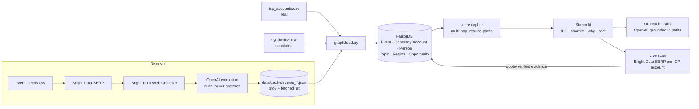

# ConferenceOS

Explainable conference shortlisting for **LabFlow** (a fictional life-science R&D SaaS vendor).

> Which Q1-Q2 2027 life-science conferences in the US and EU should we shortlist, and why?

## Setup

```bash
python3 -m venv .venv && .venv/bin/pip install -r requirements.txt
cp .env.example .env   # fill in FalkorDB, Bright Data, OpenAI keys
.venv/bin/python scripts/check_falkordb.py
```

FalkorDB runs on FalkorDB Cloud. `docker compose up` is a local fallback.

## Data provenance

| Data | Status |
|---|---|
| Events, speakers, sponsors, prices | **Real**, scraped via Bright Data, tagged `scraped` + `fetched_at` |
| ICP target accounts (`data/icp_accounts.csv`) | **Real** public life-science companies |
| Travel costs, prior-year exhibitor attendance | **Estimated**, tagged `estimated` |
| LabFlow customers, pipeline, past-event outcomes | **Simulated**, labeled "simulated" in the UI |

If scraping fails, the app falls back to `data/cache/*.json` and shows a warning badge.

## Run the demo

```bash
.venv/bin/python scripts/gen_synthetic.py      # simulated pipeline + past outcomes
.venv/bin/python scripts/discover.py           # Bright Data -> data/cache/events_*.json
.venv/bin/python scripts/discover.py --retry-incomplete
.venv/bin/python scripts/enrich.py             # speakers + exhibitors pages
.venv/bin/python scripts/seed_graph.py         # cache -> FalkorDB
.venv/bin/streamlit run app/streamlit_app.py
.venv/bin/python -m pytest -q
```

## Architecture



### Scoring

- **Presence**: an ICP account is present at an event if it `SPONSORS` it (scraped), `ATTENDS` it
  (prior-year exhibitor, *estimated*), or employs a person who `SPEAKS_AT` it (scraped, 2 hops).
- **Density**: accounts present / total ICP accounts
- **Cost**: passes + booth + travel; each item tagged scraped or estimated
- **Rank**: ICP target accounts reached per $10k. Each hit returns the graph path that explains it.
